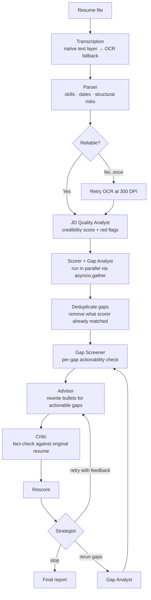

# ResumeATS

> Most ATS analyzers wrap a single prompt: *"rate this resume."* This one runs a six-agent pipeline that scores, interrogates, rewrites, fact-checks, and routes — iteratively — until the result is worth keeping.

---

## What makes it different

**It reads the job description before it reads your resume.**
A JD Quality Analyst agent scores the posting itself (0–100) and flags unrealistic experience demands, keyword stuffing, ghost job signals, and copy so vague it's useless to optimize against. If the JD is junk, you'll know before spending three refinement rounds on it.

**Scoring explains itself.**
The Scorer doesn't just return 76. It maps every concrete JD requirement — specific tools, frameworks, methodologies — to `covered`, `partial`, or `missing`, with the exact resume sentence that covers it. You see which requirements are addressed and which aren't, not a black-box number.

**The Advisor only attempts what it can actually ground.**
Before rewriting a single bullet, a Gap Screener assesses each gap independently: *does this resume have real experience to reframe here?* Gaps with no grounding are marked `screened` and skipped. The Advisor never fabricates. The Critic has less to reject.

**Rewrites are fact-checked against your original resume.**
The Critic runs a `verify_in_resume` tool call on every suggested rewrite, comparing it against the original — not the revised version — across all rounds. If a suggestion introduces a claim you never made, it's rejected and the reason feeds the next round.

**The loop is routed by an agent, not a counter.**
After each refinement round, a Strategist reviews the score delta, rejection summary, and round number to decide: stop, retry the Advisor with directed feedback, or trigger a full gap reanalysis. That's a reasoning decision, not a `for i in range(3)`.

**Every gap has a tracked lifecycle.**
The final report shows what happened to each gap: closed in round N by which rewrite, attempted but Critic-rejected, screened as not actionable, or still open. You get an audit trail, not just the output.

---

## The pipeline



---

## Agents

| Agent | Role |
|---|---|
| **Parser** | Extracts skills, education, years of experience, and structural ATS risks. Self-checks reliability — if the transcription looks garbled, it retries OCR at higher DPI before proceeding. |
| **JD Quality Analyst** | Scores the job description 0–100. Flags unrealistic seniority demands, 15+ required skills, ghost job copy, and descriptions too vague to analyze. Runs before any resume work. |
| **Scorer** | Scores resume-to-JD fit and produces a requirement coverage matrix — every concrete JD requirement mapped to covered / partial / missing with the evidence sentence. |
| **Gap Analyst** | Finds genuine technical gaps: specific skills, tools, or methodologies the JD requires that the resume doesn't demonstrate — even under different terminology. Product area names, event types, and business domains are explicitly excluded. Returns 3–7 gaps ranked by impact. |
| **Gap Screener** | Runs before every Advisor round. Assesses each gap independently — is there anything real in this resume to work with? Gaps that can't be grounded are skipped before the Advisor sees them. |
| **Advisor** | Rewrites resume bullets to close actionable gaps using the candidate's actual experience. Keywords go in as natural technical descriptors of what was done — not appended as relevance justifications at the end of a sentence. |
| **Critic** | Fact-checks every rewrite against the *original* resume using a tool, not inference. Rejects anything that invents experience the candidate never claimed — and that original stays the reference across all rounds, so round-1 hallucinations can't become round-2 ground truth. |
| **Strategist** | Reviews the score delta, rejection rate, and round count to decide: accept and stop, retry the Advisor with specific feedback, or trigger a full gap reanalysis. The decision is LLM-reasoned, not hardcoded. |

---

## What the final report contains

```json
{
  "score": {
    "match_score": 78,
    "matched_keywords": ["Python", "PyTorch", "AWS", "..."],
    "coverage": [
      {
        "requirement": "MLOps / model monitoring",
        "status": "partial",
        "covered_by": "tracked model performance metrics across..."
      },
      {
        "requirement": "Docker / containerization",
        "status": "missing",
        "covered_by": ""
      }
    ]
  },
  "jd_analysis": {
    "credibility_score": 74,
    "red_flags": ["Requires 5 YoE for a role titled 'junior engineer'"],
    "is_analyzable": true,
    "summary": "Genuine role, but overstates required seniority."
  },
  "gap_closures": [
    { "gap": "MLOps pipeline tooling", "status": "closed", "closed_in_round": 1, "closed_by": "Engineered a monitoring pipeline..." },
    { "gap": "Kubernetes", "status": "screened" },
    { "gap": "Apache Spark", "status": "attempted" }
  ],
  "final_suggestions": ["..."],
  "iterations_used": 2
}
```

---

## Stack

| Layer | Technology |
|---|---|
| Agents & orchestration | CrewAI Flow — `@start`, `@listen`, `@router` |
| LLM | OpenAI API (`gpt-4o-mini`) |
| Parallel execution | `asyncio.gather` + `Crew.akickoff()` |
| Backend | FastAPI + Uvicorn |
| Frontend | Streamlit |
| PDF extraction | `pdfplumber` (native text layer) → `pdf2image` + vision OCR (fallback) |
| DOCX extraction | `python-docx` |
| Logging | `loguru` — per-run log files in `logs/` |

---

## Setup

```bash
python -m venv venv
venv\Scripts\activate          # macOS/Linux: source venv/bin/activate
pip install -r requirements.txt
```

Create a `.env` in the project root:

```
OPENAI_API_KEY=sk-...
OPENAI_MODEL=gpt-4o-mini
MAX_OUTPUT_TOKENS=4096
```

Run backend and frontend in separate terminals:

```bash
uvicorn app.api.routes:app --reload
streamlit run frontend/streamlit_app.py
```

---

## API

**`POST /analyze`**

Multipart form with a `resume` file (PDF or DOCX) and a `job_description` string.

Returns an `AnalysisReport`: parsed resume, match score with coverage matrix, JD credibility analysis, gap closure audit, and suggested rewrites as JSON.
